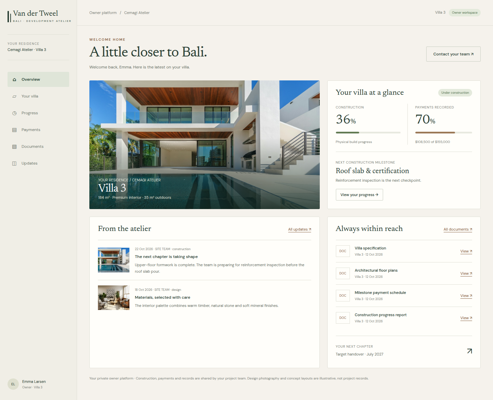
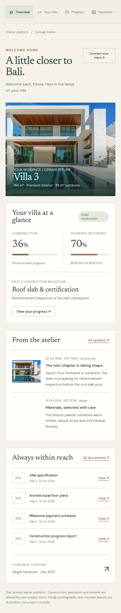
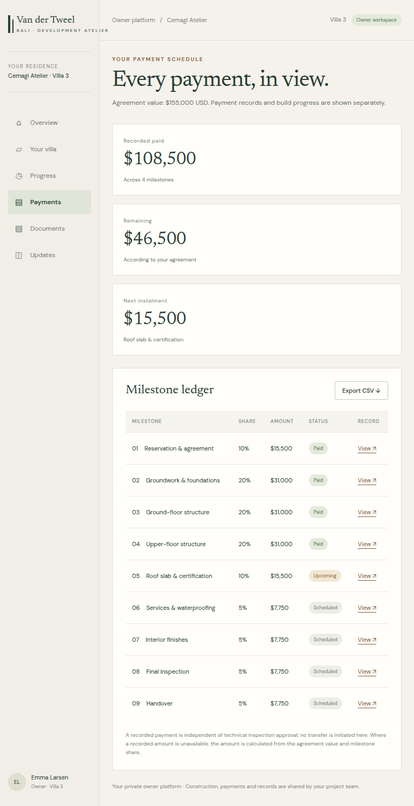

# Client platform frontend

## Scope and reference

This task implements the six **client** views from Jayden's approved [frontend demo](https://van-der-tweel-demo-jd.blue-eggs.chatgpt.site/#/client): Overview, Your villa, Progress, Payments, Documents and Updates. The public website and back-office UI are unchanged. Work is on `feature/ms3-client-platform-demo`, for review through a PR. **Do not merge until Jayden explicitly approves.**

The visual source is the demo as inspected on 30 October 2026: warm paper `#f5f2ec`, off-white panels `#fffefa`, forest ink `#283d32`, muted teak `#845b3c`, Newsreader headings and DM Sans interface text. Desktop uses a 225px residence sidebar, which becomes a horizontal, scrollable navigation on mobile. The source's mobile payment overflow is corrected with responsive metrics and an internally scrollable ledger.

## Routes and data

- `/koper`: residence overview, separate construction/payment metrics, recent updates and documents.
- `/koper/villa`: real villa specifications, illustrative concept floor tabs, inspiration gallery and actual team-uploaded photographs.
- `/koper/voortgang`: weighted construction milestones from `progress_task`.
- `/koper/betaalschema`: actual payment milestones, record details and CSV export.
- `/koper/documenten`: actual buyer-scoped project documents.
- `/koper/updates`: actual buyer-scoped team updates.

All navigation retains the authorized `?villa=` context. Each route validates the session and buyer role on the server. `client-platform-data.ts` adapts the existing `koper-data.ts` wrappers; it first resolves an authorized villa and then pins subsequent reads to that ID. An unauthorized requested villa fails closed. Only the buyer-facing fields needed for each screen cross the server/client boundary. React request memoization does not share results between users.

MS5 continues to use the existing `PollRefresh` with its 20-second refresh interval. The frontend never writes payment, construction, document or update records. Database schema, write actions, notifications, authentication and office screens are not changed.

## Deliberate differences from the demo

- No website/back-office demo switcher, localStorage records or reset button.
- Names, project details, areas, dates, milestones, payment amounts, documents and updates come from the backend, not demo fixtures.
- The backend does not expose an independent "on schedule" or "in progress" assessment. The UI shows the recorded villa status and identifies the next incomplete construction milestone without inventing an assessment.
- Payment amounts use recorded values when available, otherwise the contract value and milestone share. Missing values stay unavailable rather than appearing as zero. Construction completion and payments remain independent.
- Contact opens an informational dialog directing the owner to their existing team contact. There is no fake message form, chat service or invented contact information; buyer/team chat remains outside the PvA scope.
- The floor plan is explicitly an illustrative concept, not an approved technical drawing or an MS6 3D implementation. Real drawings remain available through shared documents.
- File dialogs open the real supplied document URL when available. Placeholder/reserved URLs are not presented as working downloads. No legal summary or invoice is fabricated.

## Asset provenance

The three illustrative photographs are the exact images supplied by the reference demo, self-hosted under `public/client-platform`:

- [Exterior](https://images.unsplash.com/photo-1613490493576-7fde63acd811?auto=format&fit=crop&w=1600&q=85)
- [Interior](https://images.unsplash.com/photo-1600210492486-724fe5c67fb0?auto=format&fit=crop&w=1000&q=85)
- [Pool](https://images.unsplash.com/photo-1576013551627-0cc20b96c2a7?auto=format&fit=crop&w=1000&q=85)

These are identified as design inspiration, not photographs of the development. Actual authorized photographs uploaded by the team appear separately on the villa screen.

The exact Google Fonts families and requested weights are self-hosted with `next/font/local`, scoped to the buyer route group. Their SIL Open Font License files are included in `src/app/(koper)/fonts`. Existing public/office typography is untouched.

## Review and verification

Use the existing project checks: `npx tsc --noEmit`, `npx vitest run`, and `npm run build`. The repository does not currently define a lint script.

Browser verification uses synthetic fixtures matching the public reference, in a temporary local-only UI harness. No production database, real buyer records, auth bypass or permanent demo route is used for this verification. The harness is removed before the final build and commit. The existing 20-second polling was also verified with a synthetic server-side record change: both the payment total and an already-open payment dialog updated without a manual reload. Authenticated staging verification of real MS5 writes remains a separate integration check requiring a legitimate buyer/team session and configured environment.

Review the buyer portal using an existing buyer account in the PR preview. Check own-villa isolation, all six navigation links, real uploaded files/photos, correct financial values and refresh after a team change. This task does not deploy or merge to production.

### Browser evidence (synthetic fixtures)

- 17 screen/viewport checks: all six screens at 1440px and 390px, overview/payments at 768px, and overview/payments/villa at 320px. No body overflow or failed images.
- Six additional edge cases at 320px: empty schedules, missing amounts, long project names, document names and unbroken update text.
- Keyboard floor tabs, gallery and record dialogs, Escape and restored focus, and active mobile navigation visibility checked.
- Downloaded CSV verified: nine fixture rows, total $155,000 and paid $108,500; presentation unit tests cover formula escaping and unknown amounts.
- Unauthenticated requests to all six client routes redirect to login. Next dev runtime/compilation inspection returned no errors.
- Desktop and mobile overview screenshots plus the corrected tablet payment layout are attached below. These are synthetic UI evidence, not screenshots of a live buyer account.

